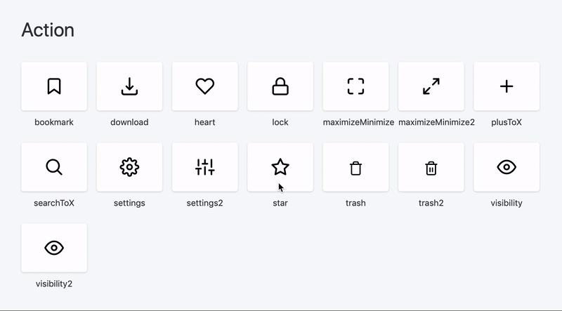

## React UseAnimations Icons

[](https://www.npmjs.com/package/react-useanimations) [](https://www.npmjs.com/package/react-useanimations)

#### What is react-useanimations?

React-useanimations is the official React component for [useAnimations](https://useanimations.com), a free library of 290+ animated Lottie icons. It has no dependencies: a built-in player (8 kB gzipped) renders the icons as SVG.

📖 **Documentation:** [useanimations.com/documentation](https://useanimations.com/documentation): React props and all import names, plus plain HTML/JS, Vue, iOS and Android guides.



### Installation

```
npm install react-useanimations
```

Requires React 18+ (tested with React 18 and 19). Works with StrictMode, Next.js (App Router) and other SSR frameworks.

### Usage

```javascript
import UseAnimations from 'react-useanimations';
// EVERY ANIMATION NEEDS TO BE IMPORTED FIRST -> YOUR BUNDLE WILL INCLUDE ONLY WHAT IT NEEDS
import github from 'react-useanimations/lib/github';

const App = () => <UseAnimations animation={github} />;

export default App;
```

Several icons can also be imported from one place; production builds still include only the icons you use:

```javascript
import { github, heart, menu } from 'react-useanimations/icons';
```

Prefer `react-useanimations/lib/<name>` when your dev server or test runner doesn't tree-shake, since `react-useanimations/icons` loads every icon there.

The component is also available as the named exports `UseAnimations` and `UseAnimation` (the name used by the [shadcn registry](https://useanimations.com/documentation)).

Icons can be configured with inline props:

```javascript
<UseAnimations animation={github} size={56} strokeColor="#2563eb" style={{ padding: 100 }} />
```

These props are available:

| Prop        |     Default      | Definition                                                                                                        |
| :---------- | :--------------: | :---------------------------------------------------------------------------------------------------------------- |
| animation   |        /         | icon imported from `react-useanimations/lib/<name>`, or `{ animationData, interaction }` for your own Lottie JSON |
| size        |       `24`       | width and height; numbers are pixels, strings are any CSS length (e.g. `'1.5em'`)                                 |
| strokeColor | `'currentColor'` | color of the icon's strokes; by default the icon follows the text color                                           |
| fillColor   |  `strokeColor`   | color of the icon's filled parts (e.g. a liked heart)                                                             |
| interaction |    per icon\*    | `'loop'`, `'click-toggle'`, `'click-replay'`, `'hover'`, `'hover-loop'` or `'hover-replay'`                       |
| active      |     `false`      | for `click-toggle` icons: `true` shows the end state (e.g. a checked checkbox); can be controlled                 |
| autoplay    |    per icon\*    | `true` for looping icons like loaders, unless reduced motion is preferred                                         |
| loop        |    per icon\*    | `true` for `loop` and `hover-loop` icons                                                                          |
| speed       |       `1`        | playback speed (1 is normal speed)                                                                                |
| render      |        /         | render prop for a custom wrapper, see below                                                                       |

\* Each icon has a default interaction matching [useanimations.com](https://useanimations.com):

- `loop`: plays continuously (loaders, alerts).
- `click-toggle`: toggles between two states on click (menu, checkbox, play/pause).
- `click-replay`: replays from the start on every click.
- `hover`: plays forward on mouse enter and backward on mouse leave.
- `hover-loop`: loops while hovered and finishes the current cycle on mouse leave (social icons).
- `hover-replay`: plays once from the start on mouse enter.

Hover animations also play on keyboard focus (when the icon or its wrapper is focusable) and ignore taps on touch screens. Looping icons pause while they are scrolled out of view.

When the user prefers reduced motion (`prefers-reduced-motion: reduce`), icons stay still: looping icons show their first frame, hover and replay animations don't play, and toggles switch to their new state immediately. Pass `autoplay` to play a loader anyway.

Any other prop (`className`, `aria-label`, `onClick`, `onMouseEnter`, …) is passed to the wrapper `<span>`. Your event handlers run before the animation's; call `event.preventDefault()` to skip the animation.

#### Colors

Icons follow the text color by default, so `className="text-blue-600"` or `style={{ color: 'red' }}` recolors them. The built-in rule has zero specificity, so your own CSS always wins:

```javascript
// Tailwind
<UseAnimations animation={github} className="text-blue-600 [&_path]:stroke-[3]" />
```

```css
/* plain CSS: <UseAnimations animation={github} className="icon" /> */
.icon path {
  stroke-width: 3;
}
```

#### Accessibility

Icons are decorative by default (`aria-hidden`). Pass `aria-label` to have the icon announced as an image. For clickable icons, put the interactive element around the icon with the `render` prop (see below) so it is focusable and works with the keyboard.

#### Controlled toggle

```javascript
import { useState } from 'react';
import UseAnimations from 'react-useanimations';
import menu from 'react-useanimations/lib/menu';

export const MenuButton = () => {
  const [open, setOpen] = useState(false);

  return (
    <UseAnimations
      animation={menu}
      size={40}
      active={open} // also animates when `open` changes elsewhere, e.g. the menu closes on Escape
      onClick={() => setOpen(!open)}
    />
  );
};
```

#### Changing the interaction

```javascript
<UseAnimations animation={download} interaction="hover" />
```

#### Your own Lottie animation

```javascript
import animationData from './my-animation.json';

<UseAnimations animation={{ animationData, interaction: 'hover' }} />;
```

The player supports what icon animations use: shape layers, precompositions, null layers and parenting, paths, rectangles, ellipses, strokes, fills, trim paths, masks, keyframes with easing, holds and motion paths, and the `loopOut()` and `wiggle()` expressions. Gradients, solid, text and image layers, effects, mattes and other expressions are not rendered; the console warns about them once per animation.

#### Wrapping the animation in another element

```javascript
import heart from 'react-useanimations/lib/heart';

export const LikeButton = () => (
  <UseAnimations
    animation={heart}
    size={60}
    onClick={() => console.log('liked')}
    render={(eventProps, animationProps) => (
      <button type="button" aria-label="Like" {...eventProps}>
        <span {...animationProps} />
      </button>
    )}
  />
);
```

`eventProps` holds the `onClick`, `onMouseEnter` and `onMouseLeave` handlers for your interactive element (e.g. a button) and `animationProps` holds the animation itself, which you spread on a `<span>` inside it.

#### Next.js and other SSR frameworks

The component is marked `'use client'` and renders the animation only in the browser, so it can be rendered from server components without `dynamic(..., { ssr: false })`.

### Available animations

<!-- icons:start -->

`activity`, `airplay`, `alertCircle`, `alertOctagon`, `alertTriangle`, `alignCenter`, `alignJustify`, `alignLeft`, `alignRight`, `anchor`, `aperture`, `archive`, `arrowDown`, `arrowDownCircle`, `arrowDownLeft`, `arrowDownRight`, `arrowLeft`, `arrowLeftCircle`, `arrowRight`, `arrowRightCircle`, `arrowUp`, `arrowUpCircle`, `arrowUpLeft`, `arrowUpRight`, `atSign`, `award`, `barChart`, `barChart2`, `battery`, `batteryCharging`, `behance`, `bluetooth`, `bold`, `book`, `bookmark`, `bookOpen`, `box`, `briefcase`, `calendar`, `camera`, `cameraOff`, `cast`, `check`, `checkBox`, `checkCircle`, `checkmark`, `chevronDown`, `chevronLeft`, `chevronRight`, `chevronsDown`, `chevronsLeft`, `chevronsRight`, `chevronsUp`, `chevronUp`, `chrome`, `circle`, `clipboard`, `clock`, `cloud`, `cloudDrizzle`, `cloudLightning`, `cloudOff`, `cloudRain`, `cloudSnow`, `code`, `codepen`, `codesandbox`, `coffee`, `columns`, `command`, `copy`, `cornerDownLeft`, `cornerDownRight`, `cornerLeftDown`, `cornerLeftUp`, `cornerRightDown`, `cornerRightUp`, `cornerUpLeft`, `cornerUpRight`, `cpu`, `creditCard`, `crop`, `crosshair`, `database`, `delete`, `disc`, `divide`, `divideCircle`, `divideSquare`, `dollarSign`, `download`, `download2`, `downloadCloud`, `dribbble`, `droplet`, `edit`, `edit2`, `edit3`, `error`, `explore`, `externalLink`, `facebook`, `fastForward`, `figma`, `file`, `fileMinus`, `filePlus`, `fileText`, `film`, `filter`, `flag`, `folder`, `folderMinus`, `folderPlus`, `framer`, `frown`, `gift`, `gitBranch`, `gitCommit`, `github`, `gitlab`, `gitMerge`, `gitPullRequest`, `globe`, `grid`, `hardDrive`, `hash`, `headphones`, `heart`, `heart2`, `help`, `hexagon`, `home`, `image`, `inbox`, `infinity`, `info`, `instagram`, `italic`, `key`, `layers`, `layout`, `lifeBuoy`, `link`, `link2`, `linkedin`, `list`, `loading`, `loading2`, `loading3`, `loading4`, `lock`, `logIn`, `logOut`, `mail`, `map`, `mapPin`, `maximize2`, `maximizeMinimize`, `maximizeMinimize2`, `meh`, `menu`, `menu2`, `menu3`, `menu4`, `messageCircle`, `messageSquare`, `micOff`, `microphone`, `microphone2`, `minimize2`, `minus`, `minusCircle`, `minusSquare`, `monitor`, `moon`, `moreHorizontal`, `moreVertical`, `mousePointer`, `move`, `music`, `navigation`, `navigation2`, `notification`, `notification2`, `notification3`, `notification4`, `octagon`, `package`, `paperclip`, `penTool`, `percent`, `phone`, `phoneCall`, `phoneForwarded`, `phoneIncoming`, `phoneMissed`, `phoneOff`, `phoneOutgoing`, `pieChart`, `playPause`, `playPauseCircle`, `plusCircle`, `plusSquare`, `plusToX`, `pocket`, `power`, `printer`, `radio`, `radioButton`, `refresh`, `refresh2`, `refreshCcw`, `repeat`, `rewind`, `rotateCcw`, `rotateCw`, `rss`, `save`, `scissors`, `scrollDown`, `searchToX`, `send`, `server`, `settings`, `settings2`, `share`, `shield`, `shieldOff`, `shoppingBag`, `shoppingCart`, `shuffle`, `sidebar`, `skipBack`, `skipForward`, `slack`, `slash`, `smartphone`, `smile`, `speaker`, `square`, `star`, `stopCircle`, `sun`, `sunrise`, `sunset`, `table`, `tablet`, `tag`, `target`, `terminal`, `thermometer`, `thumbsDown`, `thumbUp`, `toggle`, `tool`, `trash`, `trash2`, `trello`, `trendingDown`, `trendingUp`, `triangle`, `truck`, `tv`, `twitch`, `twitter`, `twitterX`, `type`, `umbrella`, `underline`, `upload`, `uploadCloud`, `user`, `userCheck`, `userMinus`, `userPlus`, `users`, `userX`, `video`, `video2`, `videoOff`, `visibility`, `visibility2`, `visibility3`, `voicemail`, `volume`, `watch`, `wifi`, `wifiOff`, `wind`, `xOctagon`, `xSquare`, `youtube`, `youtube2`, `zap`, `zapOff`, `zoomIn`, `zoomOut`
<!-- icons:end -->

Import each one from `react-useanimations/lib/<name>` or `react-useanimations/icons`. `delete` and `package` are reserved words in JavaScript: import them under another name, e.g. `import deleteIcon from 'react-useanimations/lib/delete';`, or as `deleteIcon` and `packageIcon` from `react-useanimations/icons`.

To find an icon by what it shows, search `react-useanimations/catalog.json`: every icon has its title, category, keywords (e.g. `visibility` matches `eye`, `notification` matches `bell`), default interaction, import line and a preview image. Editors show the same details when you hover an icon import.

#### The icon set outside React

The package contains the whole icon set, and [useanimations.com](https://useanimations.com) is built from it:

- `react-useanimations/catalog.json`: metadata of every icon (`name`, website `id`, `title`, `category`, `keywords`, `interaction`, `export`, `import`, static `svg` states, `preview`)
- `react-useanimations/icons`: the Lottie animation of every icon, as `{ animationData, interaction }`
- `react-useanimations/svg.json`: static SVGs of every icon's states, e.g. `svg.visibility.eye`

```javascript
import { writeFileSync } from 'node:fs';
import catalog from 'react-useanimations/catalog.json' with { type: 'json' };
import * as icons from 'react-useanimations/icons';

// Write each icon as a plain Lottie file, e.g. for lottie-web or a CDN.
for (const icon of catalog) {
  writeFileSync(`${icon.id}.json`, JSON.stringify(icons[icon.export].animationData));
}
```

### Upgrading from v2

- 211 new icons (290+ in total), matching the full set on useanimations.com.
- Requires React 18 or newer.
- Icon interactions now match useanimations.com (e.g. `zoomIn` plays on hover instead of looping, social icons loop while hovered). Pass `interaction` to keep a different behavior.
- Icons follow the text color by default (`strokeColor` defaults to `'currentColor'`, `fillColor` to `strokeColor`).
- Icons respect `prefers-reduced-motion`.
- The wrapper is an inline-block `<span>` (it was a `<div>`), so it is valid inside buttons and links. Icons are `aria-hidden` unless you pass `aria-label`.
- `reverse` is now `active` and fully controlled: changing it from `true` to `false` animates back. `reverse` still works but is deprecated.
- `pathCss` was removed: style the paths with `className` and CSS instead (see Colors). `wrapperStyle` still works but is deprecated; use `style`.
- `onMouseEnter` / `onMouseLeave` no longer replace the hover animation, and `style` is merged into the wrapper styles.
- `loop={false}` and `autoplay={false}` now override the defaults of looping icons.
- lottie-web is no longer a dependency: a built-in player renders the icons, so the `options` prop (lottie-web settings) was removed.
- The `react-useanimations/utils/*` paths were removed; import the types (`Animation`, `AnimationKey`, `Interaction`, `UseAnimationsProps`) from `react-useanimations`.

### Development

The tooling is [Vite+](https://viteplus.dev) (Vitest, Oxlint, Oxfmt and tsdown), configured in `vite.config.ts`.

```
npm install
npx playwright install chromium firefox webkit  # once, for the browser tests
npm run check       # formatting, lint and type checks (vp check)
npm run format      # fixes formatting and lint issues
npm test            # tests in Chromium, Firefox and WebKit, plus server rendering in Node
npm run build       # builds dist/: the component (vp pack) and the icon modules
npm run verify      # check, tests, build and package check
npm run icons       # validates icons/ and updates the files generated from it
```

The icon set lives in `icons/`: one Lottie file per icon (`icons/<name>.json`), the static SVGs (`icons/svg.json`) and the metadata (`icons/catalog.json`). To add an icon, add its Lottie file, its catalog entry and its SVGs, then run `npm run icons`.

### License

[MIT](LICENSE). The code and the animations are free for personal and commercial use. Attribution is not required but appreciated, e.g. "Animated icons by [useAnimations](https://useanimations.com)".
