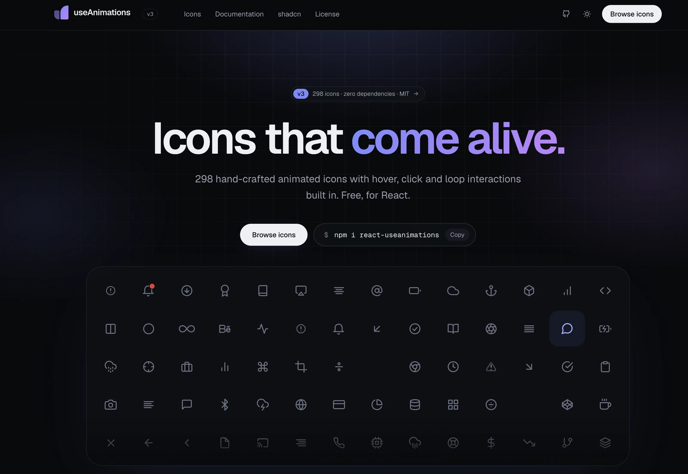

<div align="center">

# react-useanimations

The official React component for [useAnimations](https://useanimations.com):<br />
**298 free animated icons with hover, click and loop interactions built in.**

[](https://www.npmjs.com/package/react-useanimations)
[](https://www.npmjs.com/package/react-useanimations)
[](https://www.npmjs.com/package/react-useanimations?activeTab=dependencies)
[](src/index.tsx)
[](LICENSE)

[**Browse all icons →**](https://useanimations.com/#icons) &nbsp;·&nbsp; [Documentation](https://useanimations.com/documentation) &nbsp;·&nbsp; [shadcn/ui](https://useanimations.com/documentation#shadcn) &nbsp;·&nbsp; [Upgrading from v2](#upgrading-from-v2)

<a href="https://useanimations.com"></a>

</div>

## Why useAnimations

- **Every icon already knows how to move.** Loaders loop, menus toggle, the trash can opens on hover, social icons play while you point at them. You pick the icon; the interaction comes with it.
- **Tiny, zero dependencies.** A built-in 8 kB (gzipped) player renders the icons as SVG. An icon is 2 kB on median, and your bundle includes only the icons you import.
- **Styled like text.** Icons follow `currentColor`, so `className="text-blue-600"`, Tailwind and plain CSS just work.
- **Accessible and calm.** Decorative by default, labelled when you pass `aria-label`, played by keyboard focus too, and still when the user prefers reduced motion.
- **Ready for modern React.** React 18 and 19, StrictMode, Next.js App Router and server rendering, no `dynamic(..., { ssr: false })` needed.
- **Typed and searchable.** Full TypeScript types; hover an icon import in your editor to see its title, keywords, interaction and preview.
- **shadcn/ui registry.** Add any icon to your project as a ready-made component with one command.
- **Bring your own Lottie.** Your own animations play through the same player and props.

## Quick start

```bash
npm install react-useanimations
```

```jsx
import UseAnimations from 'react-useanimations';
import github from 'react-useanimations/lib/github';

export default function App() {
  return <UseAnimations animation={github} size={32} />;
}
```

Point at the icon: it loops while hovered, exactly like on [useanimations.com](https://useanimations.com). Every icon is its own module, so only what you import ends up in your bundle.

Several icons can also be imported from one place; production builds still include only the icons you use:

```javascript
import { github, heart, menu } from 'react-useanimations/icons';
```

Prefer `react-useanimations/lib/<name>` when your dev server or test runner doesn't tree-shake, since `react-useanimations/icons` loads every icon there.

The component is also available as the named exports `UseAnimations` and `UseAnimation` (the name used by the [shadcn registry](https://useanimations.com/documentation#shadcn)).

### shadcn/ui

Every icon is also in a [shadcn registry](https://useanimations.com/r/registry.json). The CLI adds a ready-made component and installs `react-useanimations`:

```bash
npx shadcn@latest add https://useanimations.com/r/checkmark.json
```

```tsx
import { AnimatedCheckmark } from '@/components/animations/checkmark';

<AnimatedCheckmark size={24} />;
```

## Interactions

Each icon comes with the interaction it has on [useanimations.com](https://useanimations.com). Pass `interaction` to pick another one.

| Interaction    | What it does                                     | For example           |
| :------------- | :----------------------------------------------- | :-------------------- |
| `hover-replay` | plays once on hover                              | `arrowRight`, `zap`   |
| `click-replay` | replays on every click                           | `download`, `send`    |
| `click-toggle` | toggles between two states on click              | `menu`, `heart`       |
| `loop`         | plays continuously                               | `loading`, `activity` |
| `hover`        | plays forward on hover, backward on leave        | `trash`, `settings`   |
| `hover-loop`   | loops while hovered, finishes the cycle on leave | `github`, `twitter`   |

```jsx
<UseAnimations animation={download} interaction="hover" />
```

Hover animations also play on keyboard focus (when the icon or its wrapper is focusable) and ignore taps on touch screens. Looping icons pause while they are scrolled out of view.

## Props

```jsx
<UseAnimations animation={github} size={56} strokeColor="#2563eb" style={{ padding: 100 }} />
```

| Prop        |     Default      | Definition                                                                                                        |
| :---------- | :--------------: | :---------------------------------------------------------------------------------------------------------------- |
| animation   |        /         | icon imported from `react-useanimations/lib/<name>`, or `{ animationData, interaction }` for your own Lottie JSON |
| size        |       `24`       | width and height; numbers are pixels, strings are any CSS length (e.g. `'1.5em'`)                                 |
| strokeColor | `'currentColor'` | color of the icon's strokes; by default the icon follows the text color                                           |
| fillColor   |  `strokeColor`   | color of the icon's filled parts (e.g. a liked heart)                                                             |
| interaction |     per icon     | `'loop'`, `'click-toggle'`, `'click-replay'`, `'hover'`, `'hover-loop'` or `'hover-replay'`                       |
| active      |        /         | for `click-toggle` icons: `true` shows the end state; controlled, so set it in `onClick` (clicks don't toggle it) |
| autoplay    |     per icon     | `true` for `loop` icons, unless reduced motion is preferred                                                       |
| loop        |     per icon     | `true` for `loop` and `hover-loop` icons                                                                          |
| speed       |       `1`        | playback speed (1 is normal speed)                                                                                |
| render      |        /         | render prop for a custom wrapper, see [A real button](#a-real-button)                                             |

Any other prop (`className`, `aria-label`, `onClick`, `onMouseEnter`, …) is passed to the wrapper `<span>`. Your event handlers run before the animation's; call `event.preventDefault()` to skip the animation.

## Recipes

### Colors and stroke width

Icons follow the text color by default, so `className="text-blue-600"` or `style={{ color: 'red' }}` recolors them. The built-in rule has zero specificity, so your own CSS always wins:

```jsx
// Tailwind
<UseAnimations animation={github} className="text-blue-600 [&_path]:stroke-[3]" />
```

```css
/* plain CSS: <UseAnimations animation={github} className="icon" /> */
.icon path {
  stroke-width: 3;
}
```

Some icons cut a gap into themselves (the slash in `visibility`, `microphone`, `video`, `volume` and `notification`, the check in `download`, the ring around `notification3`'s badge). The gap takes the page background: white on light pages and dark on pages with `color-scheme: dark`. On other backgrounds, set it with the `--ua-knockout` CSS variable, e.g. `body { --ua-knockout: #0f172a; }`.

### Controlled toggle

```jsx
import { useState } from 'react';
import UseAnimations from 'react-useanimations';
import menu from 'react-useanimations/lib/menu';

export const MenuButton = () => {
  const [open, setOpen] = useState(false);

  return (
    <UseAnimations
      animation={menu}
      size={40}
      active={open} // also animates when `open` changes elsewhere, e.g. the menu closes on Escape
      onClick={() => setOpen(!open)}
    />
  );
};
```

### A real button

For clickable icons, put an interactive element around the icon with the `render` prop, so it is focusable and works with the keyboard:

```jsx
import heart from 'react-useanimations/lib/heart';

export const LikeButton = () => (
  <UseAnimations
    animation={heart}
    size={60}
    onClick={() => console.log('liked')}
    render={(eventProps, animationProps) => (
      <button type="button" aria-label="Like" {...eventProps}>
        <span {...animationProps} />
      </button>
    )}
  />
);
```

`eventProps` holds the `onClick`, `onMouseEnter`, `onMouseLeave`, `onPointerEnter`, `onFocus` and `onBlur` handlers for your interactive element and `animationProps` holds the animation itself, which you spread on a `<span>` inside it.

### Your own Lottie animation

```jsx
import animationData from './my-animation.json';

<UseAnimations animation={{ animationData, interaction: 'hover' }} />;
```

The player supports what icon animations use: shape layers, precompositions, null layers and parenting, paths, rectangles, ellipses, strokes, fills, trim paths, masks, keyframes with easing, holds and motion paths, and the `loopOut()` and `wiggle()` expressions. Gradients, solid, text and image layers, effects, mattes and other expressions are not rendered; the console warns about them once per animation. If the player can't draw an animation, that animation stops and the error is logged once; other icons keep playing.

### Next.js and other SSR frameworks

The component is marked `'use client'` and renders the animation only in the browser, so it can be rendered from server components without `dynamic(..., { ssr: false })`. Functions such as `onClick` or `render` can't be passed from a server component: render the icon inside a client component for those. Icons inside a shadow root are styled there too.

## Accessibility and motion

- Icons are decorative by default (`aria-hidden`). Pass `aria-label` to have the icon announced as an image.
- For icon-only controls, use a real `<button>` with an `aria-label` (see [A real button](#a-real-button)) and reflect toggle state with `aria-pressed` or `aria-expanded`.
- When the user prefers reduced motion (`prefers-reduced-motion: reduce`), icons stay still: looping icons show their first frame, hover and replay animations don't play, and toggles switch to their new state immediately. Pass `autoplay` to play a loader anyway.

## Available animations

[Browse and search all 298 icons](https://useanimations.com/#icons) on the website, or expand the full list:

<details>
<summary><b>All icon names</b></summary>

<!-- icons:start -->

`activity`, `airplay`, `alertCircle`, `alertOctagon`, `alertTriangle`, `alignCenter`, `alignJustify`, `alignLeft`, `alignRight`, `anchor`, `aperture`, `archive`, `arrowDown`, `arrowDownCircle`, `arrowDownLeft`, `arrowDownRight`, `arrowLeft`, `arrowLeftCircle`, `arrowRight`, `arrowRightCircle`, `arrowUp`, `arrowUpCircle`, `arrowUpLeft`, `arrowUpRight`, `atSign`, `award`, `barChart`, `barChart2`, `battery`, `batteryCharging`, `behance`, `bluetooth`, `bold`, `book`, `bookmark`, `bookOpen`, `box`, `briefcase`, `calendar`, `camera`, `cameraOff`, `cast`, `check`, `checkBox`, `checkCircle`, `checkmark`, `chevronDown`, `chevronLeft`, `chevronRight`, `chevronsDown`, `chevronsLeft`, `chevronsRight`, `chevronsUp`, `chevronUp`, `chrome`, `circle`, `clipboard`, `clock`, `cloud`, `cloudDrizzle`, `cloudLightning`, `cloudOff`, `cloudRain`, `cloudSnow`, `code`, `codepen`, `codesandbox`, `coffee`, `columns`, `command`, `copy`, `cornerDownLeft`, `cornerDownRight`, `cornerLeftDown`, `cornerLeftUp`, `cornerRightDown`, `cornerRightUp`, `cornerUpLeft`, `cornerUpRight`, `cpu`, `creditCard`, `crop`, `crosshair`, `database`, `delete`, `disc`, `divide`, `divideCircle`, `divideSquare`, `dollarSign`, `download`, `download2`, `downloadCloud`, `dribbble`, `droplet`, `edit`, `edit2`, `edit3`, `error`, `explore`, `externalLink`, `facebook`, `fastForward`, `figma`, `file`, `fileMinus`, `filePlus`, `fileText`, `film`, `filter`, `flag`, `folder`, `folderMinus`, `folderPlus`, `framer`, `frown`, `gift`, `gitBranch`, `gitCommit`, `github`, `gitlab`, `gitMerge`, `gitPullRequest`, `globe`, `grid`, `hardDrive`, `hash`, `headphones`, `heart`, `heart2`, `help`, `hexagon`, `home`, `image`, `inbox`, `infinity`, `info`, `instagram`, `italic`, `key`, `layers`, `layout`, `lifeBuoy`, `link`, `link2`, `linkedin`, `list`, `loading`, `loading2`, `loading3`, `loading4`, `lock`, `logIn`, `logOut`, `mail`, `map`, `mapPin`, `maximize2`, `maximizeMinimize`, `maximizeMinimize2`, `meh`, `menu`, `menu2`, `menu3`, `menu4`, `messageCircle`, `messageSquare`, `micOff`, `microphone`, `microphone2`, `minimize2`, `minus`, `minusCircle`, `minusSquare`, `monitor`, `moon`, `moreHorizontal`, `moreVertical`, `mousePointer`, `move`, `music`, `navigation`, `navigation2`, `notification`, `notification2`, `notification3`, `notification4`, `octagon`, `package`, `paperclip`, `penTool`, `percent`, `phone`, `phoneCall`, `phoneForwarded`, `phoneIncoming`, `phoneMissed`, `phoneOff`, `phoneOutgoing`, `pieChart`, `playPause`, `playPauseCircle`, `plusCircle`, `plusSquare`, `plusToX`, `pocket`, `power`, `printer`, `radio`, `radioButton`, `refresh`, `refresh2`, `refreshCcw`, `repeat`, `rewind`, `rotateCcw`, `rotateCw`, `rss`, `save`, `scissors`, `scrollDown`, `searchToX`, `send`, `server`, `settings`, `settings2`, `share`, `shield`, `shieldOff`, `shoppingBag`, `shoppingCart`, `shuffle`, `sidebar`, `skipBack`, `skipForward`, `slack`, `slash`, `smartphone`, `smile`, `speaker`, `square`, `star`, `stopCircle`, `sun`, `sunrise`, `sunset`, `table`, `tablet`, `tag`, `target`, `terminal`, `thermometer`, `thumbsDown`, `thumbUp`, `toggle`, `tool`, `trash`, `trash2`, `trello`, `trendingDown`, `trendingUp`, `triangle`, `truck`, `tv`, `twitch`, `twitter`, `twitterX`, `type`, `umbrella`, `underline`, `upload`, `uploadCloud`, `user`, `userCheck`, `userMinus`, `userPlus`, `users`, `userX`, `video`, `video2`, `videoOff`, `visibility`, `visibility2`, `visibility3`, `voicemail`, `volume`, `watch`, `wifi`, `wifiOff`, `wind`, `xOctagon`, `xSquare`, `youtube`, `youtube2`, `zap`, `zapOff`, `zoomIn`, `zoomOut`
<!-- icons:end -->

</details>

Import each one from `react-useanimations/lib/<name>` or `react-useanimations/icons`. `delete` and `package` are reserved words in JavaScript: import them under another name, e.g. `import deleteIcon from 'react-useanimations/lib/delete';`, or as `deleteIcon` and `packageIcon` from `react-useanimations/icons`.

To find an icon by what it shows, search `react-useanimations/catalog.json`: every icon has its title, category, keywords (e.g. `visibility` matches `eye`, `notification` matches `bell`), default interaction, import line and a preview image (except `calendar`, `loading`, `loading2`, `loading3`, `zoomIn` and `zoomOut`, which have no static SVG).

### The icon set outside React

The package contains the whole icon set, and [useanimations.com](https://useanimations.com) is built from it:

- `react-useanimations/catalog.json`: metadata of every icon (`name`, website `id`, `title`, `category`, `keywords`, `interaction`, `export`, `import`, static `svg` states, `preview`)
- `react-useanimations/icons`: the Lottie animation of every icon, as `{ animationData, interaction }`
- `react-useanimations/svg.json`: static SVGs of the icons' states, e.g. `svg.visibility.eye` (all icons except the six listed above)

```javascript
import { writeFileSync } from 'node:fs';
import catalog from 'react-useanimations/catalog.json' with { type: 'json' };
import * as icons from 'react-useanimations/icons';

// Write each icon as a plain Lottie file, e.g. for a CDN or a native app.
for (const icon of catalog) {
  writeFileSync(`${icon.id}.json`, JSON.stringify(icons[icon.export].animationData));
}
```

## Upgrading from v2

Imports and the component stay the same, and all 79 v2 icons are still there. The full guide, with before/after code, is at [useanimations.com/documentation#upgrading-from-v2](https://useanimations.com/documentation#upgrading-from-v2).

<details>
<summary><b>What changed in v3</b></summary>

- Requires React 18 or newer; lottie-web is no longer a dependency, so remove it unless something else uses it.
- `reverse` is now `active`, fully controlled: update it in `onClick`, a click alone doesn't toggle the icon (`reverse` still works as in v2 but is deprecated).
- Import icons only as `react-useanimations/lib/<name>` (or from `react-useanimations/icons`): internal paths such as `lib/github/index` or `lib/github/github.json` no longer resolve; the Lottie JSON is the icon's `animationData`.
- Icons follow the text color (`currentColor`); set `strokeColor="#000"` to keep them black.
- `wrapperStyle` is deprecated (use `style`); `pathCss` and `options` were removed (use CSS, and the `loop`, `autoplay` and `speed` props; passing them logs a warning once).
- The wrapper is an inline-block `<span>` instead of a `<div>`, hidden from screen readers unless you pass `aria-label`; spread `animationProps` on a `<span>` in the `render` prop.
- 26 icons now play the interaction they have on useanimations.com (e.g. `zoomIn` plays on hover instead of looping, `github` loops on hover instead of playing once, the arrow circles replay on click instead of toggling); pass `interaction` to keep the old behavior.
- Types come from `react-useanimations` (`Animation`, `AnimationKey`, `Interaction`, `UseAnimationsProps`); the `react-useanimations/utils` paths were removed.
- New: 219 more icons (298 in total), `react-useanimations/icons`, reduced-motion support and server rendering without workarounds.

</details>

## Development

The tooling is [Vite+](https://viteplus.dev) (Vitest, Oxlint, Oxfmt and tsdown), configured in `vite.config.ts`.

```bash
npm install
npx playwright install chromium firefox webkit  # once, for the browser tests
npm run check       # formatting, lint and type checks (vp check)
npm run format      # fixes formatting and lint issues
npm test            # tests in Chromium, Firefox and WebKit, plus server rendering in Node
npm run build       # builds dist/: the component (vp pack) and the icon modules
npm run verify      # check, tests, build and package check
npm run icons       # validates icons/ and updates the files generated from it
npm run website:dev # useanimations.com, built from the same icons and component
```

The icon set lives in `icons/`: one Lottie file per icon (`icons/<name>.json`), the static SVGs (`icons/svg.json`) and the metadata (`icons/catalog.json`). To add an icon, add its Lottie file, its catalog entry and its SVGs, then run `npm run icons`.

## License

[MIT](LICENSE). The code and the animations are free for personal and commercial use. Attribution is not required but appreciated, e.g. "Animated icons by [useAnimations](https://useanimations.com)".

<div align="center">
<br />

**[useanimations.com](https://useanimations.com)** &nbsp;·&nbsp; [X](https://twitter.com/useAnimations/) &nbsp;·&nbsp; [Instagram](https://www.instagram.com/getuseanimations/) &nbsp;·&nbsp; [Facebook](https://www.facebook.com/useanimations/)

</div>
